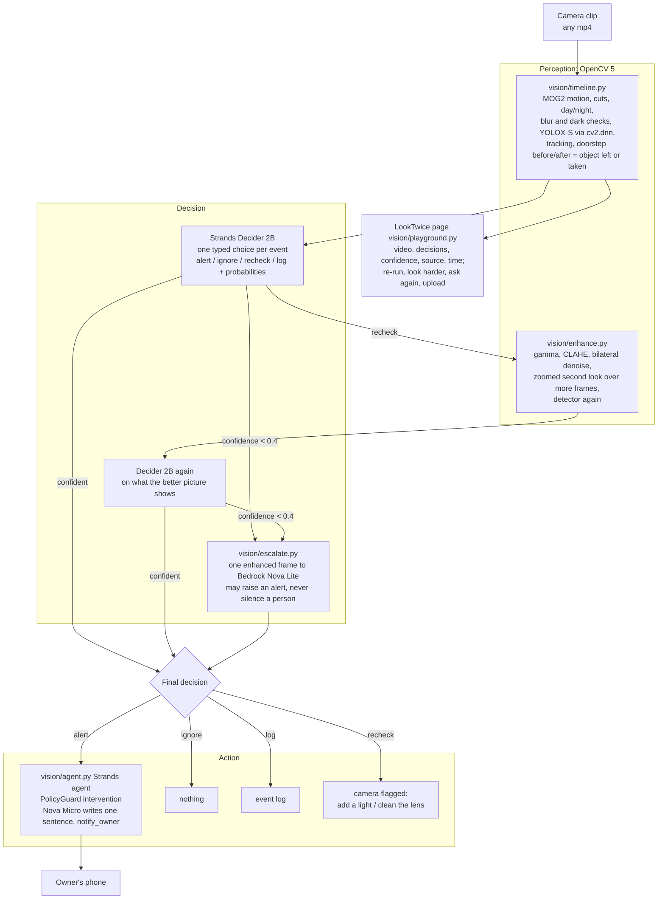
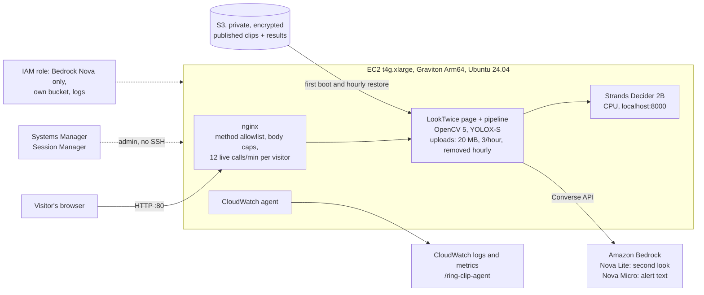

# Architecture

LookTwice: OpenCV 5 finds what happened and whether the picture can be trusted, Strands Decider 2B decides what
to do about it, OpenCV looks again when the picture is poor, Amazon Bedrock settles the unsure cases, and a
Strands agent writes the notification only when one is needed.

## Agent workflow: perception, decision, action

Every step is written to the clip's `*.timeline.json`: `first_decision`, `recheck` (before and after
measurements), `decider_decision` when escalated, `vision_decision` when a second look was overruled, and the
final `decision` with `source`, `confidence`, `ms`, and Bedrock `tokens`.

## AWS deployment

Built by Terraform (`deploy/terraform`): `terraform apply` builds it, `terraform destroy` removes it.

| Part | Where | Why |
|---|---|---|
| OpenCV 5 pipeline and the LookTwice page | EC2 t4g.xlarge (Graviton) | the vision work runs on Arm CPU; one instance keeps the demo simple |
| Strands Decider 2B | same instance, CPU | about 7 to 8 s a decision, about 5.5 GB of memory; no GPU needed for a drop box |
| Second look and alert text | Amazon Bedrock, Nova Lite and Nova Micro | pay per call, about $0.00007 each; called for about 1 event in 4 |
| Published clips | S3 | only the clips in `deploy/published_clips.txt` |
| Logs and metrics | CloudWatch | setup, decider, page, and nginx streams; memory and CPU |
| Admin | Systems Manager | no SSH port and no keys on the server |

## Data

- `eval/cc_clips.csv` + 2 Pexels clips: the 10 published, shareable clips used for the benchmark and the demo.
- `eval/real_clips.csv`: 18 labelled public doorbell clips used during development (listed, not redistributed).
- `web/public/samples/*.timeline.json`: per-frame measurements, events, and every decision with its source.
