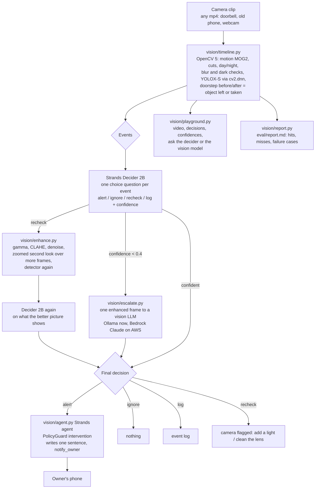

# Architecture

Smart alerts for any camera: OpenCV 5 finds what happened and whether the picture can be trusted,
Strands Decider 2B decides what to do about it, a vision model settles the unsure cases, and a Strands
agent writes the notification only when one is needed.

## AWS deployment (planned, under $5)

| Part | Where | Why |
|---|---|---|
| OpenCV pipeline (`vision/Dockerfile`) | container on a small EC2 instance | the "meaningful component on AWS"; CPU is enough |
| Strands Decider 2B | g6.xlarge GPU instance for test and demo sessions only | ~10 s per decision on a laptop CPU, ~115 ms on a GPU |
| Vision escalation and the agent's language model | Amazon Bedrock (Claude) | required by the Strands hackathon; pay per call, cents for a test |
| Playground / demo endpoint | same instance, port 8090, scheduled screen-share for judges | OpenCV rules: live endpoint or arranged demo |

## Data

- `clips/real`: 18 labelled doorbell clips (`eval/real_clips.csv`), deliveries and thefts, 4 at night.
- `clips/pexels`: 6 free-licence doorstep clips usable in the submission.
- `clips/blurry`: 5 clips with foggy, wet or smudged lenses.
- `web/public/samples/*.timeline.json`: per-frame measurements, events, every decision with its source.
