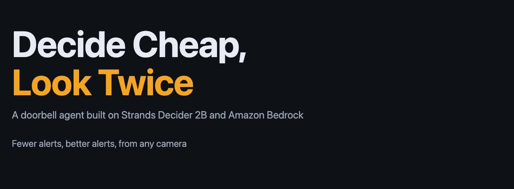
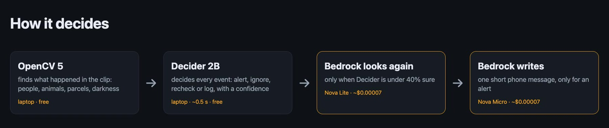
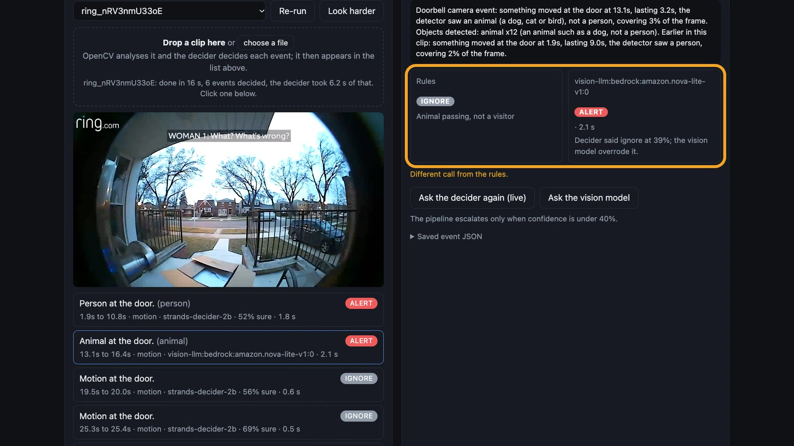
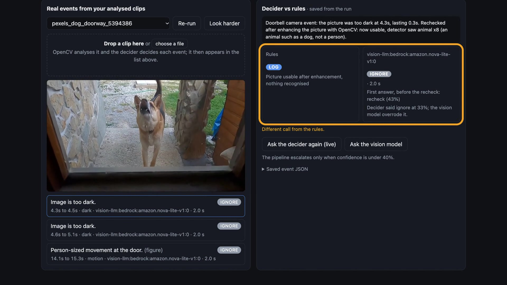
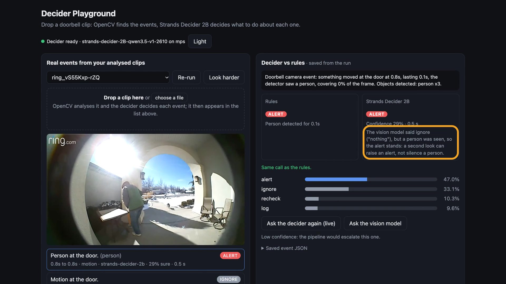

# Decide Cheap, Look Twice: A Doorbell Agent Built on Strands Decider 2B



- **Demo video (2:55):** [youtu.be/ivwJz-WfAxc](https://youtu.be/ivwJz-WfAxc)
- **Code (MIT):** [github.com/yashrajshrestha/ring-clip-agent](https://github.com/yashrajshrestha/ring-clip-agent)
- **Decision pattern:** Policy, plus confidence-based routing to Amazon Bedrock

## The problem

My doorbell camera pings me for everything: a cat, a car, a shadow. So I stopped looking. Then there's the
opposite problem. When the porch is dark or the moment is quick, the camera can miss the one thing that matters.
The smart alerts that fix this usually cost $18–20 a month and only work with one brand of camera.

I wanted alerts that work with **any** camera, even an old phone, with no subscription. And I wanted the
system to be honest when it can't see clearly.

## The idea in one sentence

Let a small, free model make every decision, and call a bigger model **only when the small one isn't sure**.

## How it works



1. **OpenCV 5 watches the clip** and turns it into events: a person, an animal, a car, a parcel left or taken,
   a dark or blurry stretch.
2. **Strands Decider 2B decides each event**: alert, ignore, recheck, or log. It runs on my laptop in about half
   a second, costs nothing, and gives a confidence score with every answer.
3. **If Decider is less than 40% sure, Amazon Bedrock takes a second look.** One frame goes to Nova Lite, which
   picks from the same four options.
4. **Only for a real alert, Bedrock writes the phone message.** A Strands agent uses Nova Micro, and a guard
   blocks it from sending anything that isn't an alert.

## What it looks like on real doorbell footage

I tested it on eight Creative Commons clips from Ring's own YouTube channel and two free stock clips.

**Two thieves, mistaken for "an animal."** The detector got it wrong. Decider said ignore, but it was only 39%
sure, so Bedrock looked and said: *"Two people are at the door, one is holding a package."* Alert. The phone
message read: *"Two people are at your door, one holding a package and the other opening it."*



**A bear took a parcel.** Yes, really. The agent didn't need to know it was a bear. It saw the parcel was gone
and sent an alert.

**Pets stayed quiet.** A cat sat on the boxes and a German Shepherd stood in a dark doorway. Both times, no
alert. In the dark doorway Decider wasn't sure, so Bedrock looked and saw the dog.



## The race: four ways to decide the same clips

I ran the same 10 clips through four approaches. Seven clips should trigger an alert; three show only a pet
and shouldn't.

| Approach | Visits caught | Pets kept quiet | Bedrock calls | Cost |
|---|---|---|---|---|
| Simple rules | 7 / 7 | 0 / 3 | 0 | $0 |
| Decider alone | 7 / 7 | 2 / 3 | 0 | $0 |
| **Decider + Bedrock when unsure** | **7 / 7** | **3 / 3** | **9** | **$0.0006** |
| Bedrock on everything | 4 / 7 | 3 / 3 | 35 | $0.0023 |

The surprise: **sending everything to the bigger model was worse.** From a single frame, it often said
"nothing at the door," even during a theft. Letting Decider go first got every clip right, with a quarter of
the Bedrock calls and about a third of the time.

## The one rule I had to add

My first version let Bedrock overrule anything, and that caused a miss. Bedrock only sees one frame, and on a
split-second event, that frame can be empty. It said "nothing here" over a person the camera had clearly seen.

So I added one rule: **a second look can add an alert, but it can never cancel one where a person was seen.**
After that fix, all seven visits were caught and the pets still stayed quiet.



## What I learned

- **Wording matters more than anything.** Same model, same events, only the description changed. Plain
  English ("the doorstep looks different after the visit, so something was left or taken") took agreement with
  my baseline from 30 out of 70 to 65 out of 70.
- **The confidence score is the real feature.** The events Decider was unsure about were exactly the hard ones.
  That one number decides when the bigger model is worth calling.
- **Small vision models copy your prompt.** If you tell one "the detector saw nothing," it repeats that instead
  of looking. Ask it to describe the picture first.

## Reuse it in your own agent

The pattern is four plain-English options, a confidence cutoff for routing to Bedrock, a guard in front of the
expensive tool, and the "never cancel a person" rule. It's all in `PATTERN.md` in the repo.

```python
CRITERIA = {
    "alert":   "Notify the owner now: a person is at the door, or something was left or taken.",
    "ignore":  "Do nothing: an animal, a passing car, shadows, or tiny brief motion.",
    "recheck": "The picture is too blurry or dark to trust; look again.",
    "log":     "Keep a note only: a camera mode change, nothing at the door.",
}

def may_override(ev, decision, answer):
    """A second look may raise an alert, never cancel one where a person was seen."""
    cancels = decision["action"] == "alert" and answer["action"] != "alert"
    return not (cancels and ev.get("label") in ("person", "figure"))
```

## The honest fine print

- Ten clips is a small test. On a larger set of 18 labeled delivery and theft clips, it alerted on all 18.
- Spotting a parcel is the weak spot: it compares the doorstep before and after, so small or nighttime parcels
  get missed sometimes.
- This isn't a claim to beat Ring. Its own detectors are probably better. What this adds is that it works with
  any camera, says when it can't see, and shows its reasoning.
- Speed: Decider takes about 0.5 seconds per decision on an Apple M2 Pro laptop (model
  `strands-decider-2B-qwen3.5-v1-2610`). A Bedrock second look takes about 2 seconds.

---

*Doorbell clips: RingTV (Ring LLC), licensed Creative Commons Attribution (CC BY 3.0), youtube.com/@Ring.
Stock clips: Pexels. Video narration: Amazon Polly.*

#strands-decider-2b #policy
